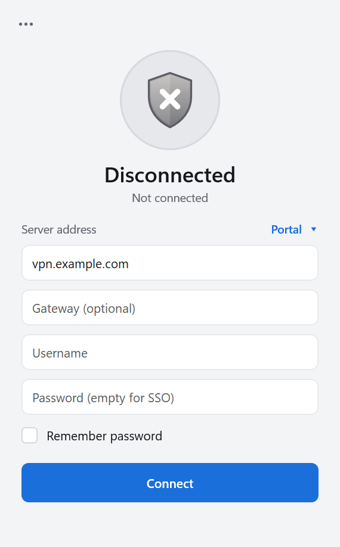
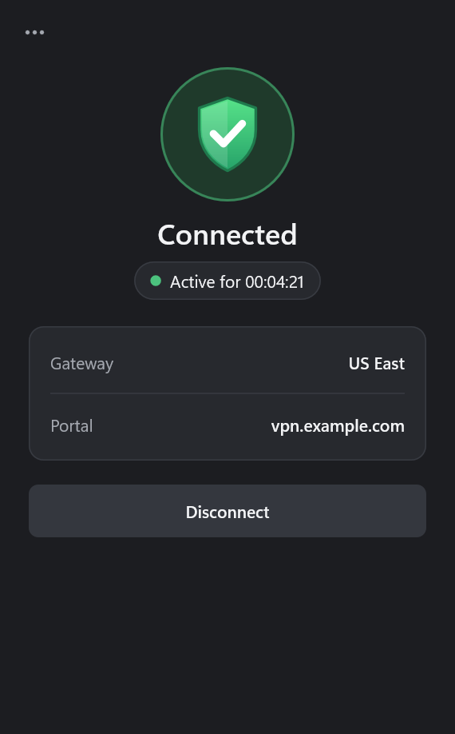
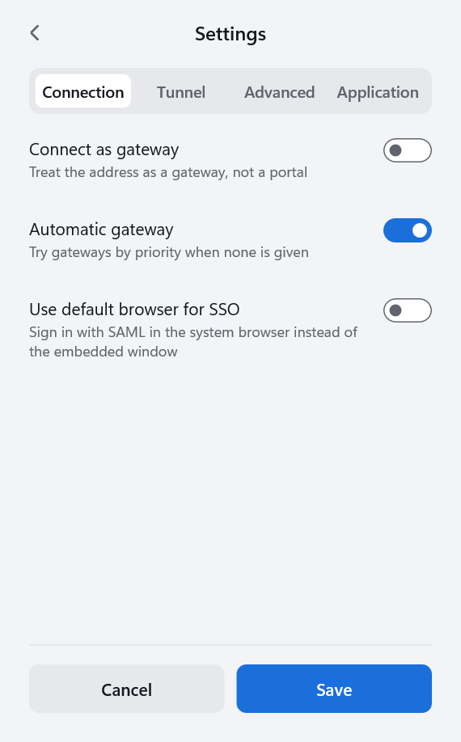

# GlobalProtect VPN (open-source GUIs for GlobalProtect-openconnect)

Open-source desktop apps for connecting to Palo Alto GlobalProtect VPNs, built on
[GlobalProtect-openconnect](https://github.com/yuezk/GlobalProtect-openconnect) and OpenConnect.

- **Windows**: `gpgui-win`, a native Win32 + Direct2D app for x64 and ARM64.
- **Linux**: `gpgui-gtk`, a GTK4/libadwaita app for x86_64 and aarch64.

Both apps are called **GlobalProtect VPN**, offer the same features, and ship with the VPN service (`gpservice`) and sign-in helper (`gpauth`) built from this repository.

<p align="center">
  
  
  
</p>

> This is a fork of [yuezk/GlobalProtect-openconnect](https://github.com/yuezk/GlobalProtect-openconnect).
> For the **command-line client (`gpclient`)**, the official **GP Connect** app, and distribution packages
> (Homebrew, PPA, AUR, COPR, Nix, Docker…), see the upstream project:
> [CLI usage](https://github.com/yuezk/GlobalProtect-openconnect#command-line-interface) ·
> [Installation](https://github.com/yuezk/GlobalProtect-openconnect#installation).

## Table of Contents

- [Features](#features)
- [Install on Windows](#install-on-windows)
- [Install on Linux](#install-on-linux)
- [Using the app](#using-the-app)
- [Building from source](#building-from-source)
- [Limitations](#limitations)
- [Licensing](#licensing)

## Features

- Connect to a portal or directly to a gateway, with optional gateway selection and a list of recent portals
- Sign-in with SAML/SSO (embedded window or default browser), username/password, and MFA / one-time codes
- Remembered password, stored in Windows Credential Manager or the Linux Secret Service
- Notification-area (tray) icon showing the status, with Connect/Disconnect, Show Window and Quit
- Auto reconnect with exponential back-off, plus re-authentication when the gateway requires it
- Connection log (⋯ › Show Log, Ctrl+L) with Copy / Clear
- Settings for automatic gateway, connect as gateway, TLS only (no DTLS/ESP), IPv4 only, MTU, reported OS and client version, ignore TLS errors, close to tray, start minimized
- Windows only: the window opens next to the tray, settings open inside the window, *Start with Windows*, light/dark theme, per-monitor DPI
- Like the official GUI, sign-in runs as your user and only the tunnel runs privileged, so connecting needs no admin password

## Install on Windows

Requires Windows 10 version 2004 (build 19041) or later, or Windows 11, on **x64** or **ARM64**.

1. Download the installer for your PC from the [latest release](https://github.com/leeanh1999/GlobalProtect-openconnect/releases/latest):
   - `GlobalProtectVPN-<version>-x64-setup.exe` for Intel/AMD PCs
   - `GlobalProtectVPN-<version>-arm64-setup.exe` for Windows on ARM (e.g. Snapdragon)
2. Optionally, check the download against its `.sha256` file:
   ```powershell
   Get-FileHash .\GlobalProtectVPN-*-x64-setup.exe   # compare with the .sha256 file
   ```
3. Run the installer and approve the administrator prompt.
   - The installer is **not code-signed**, so SmartScreen may show *Windows protected your PC*. Click **More info › Run anyway**.
   - If the official **GP Connect** is installed, uninstall it first; both use the same Windows service (`GPConnect`).
4. Open **GlobalProtect VPN** from the Start menu. It appears next to the notification area and adds a tray icon.

The installer places the app in `C:\Program Files\GlobalProtect VPN` and registers the `GPConnect` service, which starts automatically with Windows.

**Update:** run the newer installer; it updates in place. **Uninstall:** go to *Settings › Apps › Installed apps › GlobalProtect VPN › Uninstall*. Your settings are kept in `%APPDATA%\GlobalProtect VPN`.

## Install on Linux

Release tarballs are built on Ubuntu 24.04 (glibc 2.39) for **x86_64** and **aarch64**.

1. Install the runtime packages (Debian/Ubuntu):
   ```sh
   sudo apt install libgtk-4-1 libadwaita-1-0 libwebkit2gtk-4.1-0 pkexec
   ```
2. Download `gpgui-gtk-<version>-linux-<arch>.tar.gz` from the [latest release](https://github.com/leeanh1999/GlobalProtect-openconnect/releases/latest), then install:
   ```sh
   tar xzf gpgui-gtk-*-linux-$(uname -m).tar.gz
   cd gpgui-gtk-*-linux-$(uname -m)
   sudo sh apps/gpgui-gtk/install.sh
   ```
3. Launch **GlobalProtect VPN** from the app menu, or run `gpgui-gtk`.

`install.sh` installs `gpservice`, `gpclient`, `gpauth` and `gpgui-gtk` to `/usr/bin`, along with the helpers in `/usr/libexec/gpclient/` and the upstream polkit policy. The policy lets active local users start the VPN service without a password.

Notes:
- On GNOME, the tray icon needs the [AppIndicator extension](https://extensions.gnome.org/extension/615/appindicator-support/).
- On Linux, quitting the app stops the private `gpservice` and disconnects. Use *Close to tray* to keep the VPN running.

## Using the app

1. Enter the **portal** address. Open the **Portal ▾** menu to switch to **Gateway** if you connect directly to a gateway.
2. Optionally enter a gateway, plus your **username** and **password**. Leave the password empty for SSO; a sign-in window or your browser will open.
3. Click **Connect**. If MFA is enabled, a *Verification code* prompt appears.
4. Once connected, the window shows the gateway and how long the connection has been active. Click **Disconnect** to end it.

On Windows, quitting the app keeps the VPN connected; reopen the app at any time to see the live status. If the VPN is still connected when you choose **Quit**, the app asks whether to keep the VPN or disconnect.

## Building from source

```sh
git clone https://github.com/leeanh1999/GlobalProtect-openconnect.git
cd GlobalProtect-openconnect
git submodule update --init --recursive
```

- **Windows**: needs rustup (MSVC), Visual Studio Build Tools (C++), MSYS2 and NSIS. Run
  `powershell -ExecutionPolicy Bypass -File scripts\build-gpgui-win.ps1`; it writes the installer to
  `target\windows-oss\`. See [apps/gpgui-win/README.md](apps/gpgui-win/README.md).
- **Linux**: install the packages listed in [.github/workflows/gpgui.yaml](.github/workflows/gpgui.yaml), then run
  `cargo build --release -p gpservice -p gpclient -p gpauth -p gpgui-gtk` and `sudo sh apps/gpgui-gtk/install.sh`.
  See [apps/gpgui-gtk/README.md](apps/gpgui-gtk/README.md).

CI ([gpgui.yaml](.github/workflows/gpgui.yaml)) builds Linux x86_64/aarch64 tarballs and Windows x64/ARM64 installers on every push. Pushing a `gui-v*` tag publishes a release.

## Limitations

- No HIP reports on Windows: they need a proprietary posture helper that is not included.
- Internal (non-tunnel) gateways are not supported yet.
- Windows installers are not code-signed.

## Licensing

The apps in this fork are free and open source (GPL-3.0). The official GP Connect app from the upstream project is a separate commercial product.

| Component | Type | License |
|-----------|------|---------|
| [gpgui-win](./apps/gpgui-win) | Application (Windows GUI) | [GPL-3.0](./LICENSE) |
| [gpgui-gtk](./apps/gpgui-gtk) | Application (Linux GUI) | [GPL-3.0](./LICENSE) |
| [gpdesktop](./crates/gpdesktop) | Crate (shared GUI core) | [GPL-3.0](./LICENSE) |
| [gpservice](./apps/gpservice) | Application | [GPL-3.0](./apps/gpservice/LICENSE) |
| [gpclient](./apps/gpclient) | Application | [GPL-3.0](./apps/gpclient/LICENSE) |
| [gpauth](./apps/gpauth) | Application | [GPL-3.0](./apps/gpauth/LICENSE) |
| [gpapi](./crates/gpapi) | Crate | [MIT](./crates/gpapi/LICENSE) |
| [openconnect](./crates/openconnect) | Rust wrapper crate | [MIT](./crates/openconnect/LICENSE) |
| [upstream OpenConnect](./crates/openconnect/deps/openconnect) | C library | [LGPL-2.1](./crates/openconnect/deps/openconnect/COPYING.LGPL) |
| [common](./crates/common) | Crate | [MIT](./crates/common/LICENSE) |
| [browser-launcher](./crates/browser-launcher) | Crate | [MIT](./crates/browser-launcher/LICENSE) |
| [auth](./crates/auth) | Crate | [GPL-3.0](./crates/auth/LICENSE) |

Wintun (bundled in the Windows installer) is © WireGuard LLC and is distributed under its own license.
